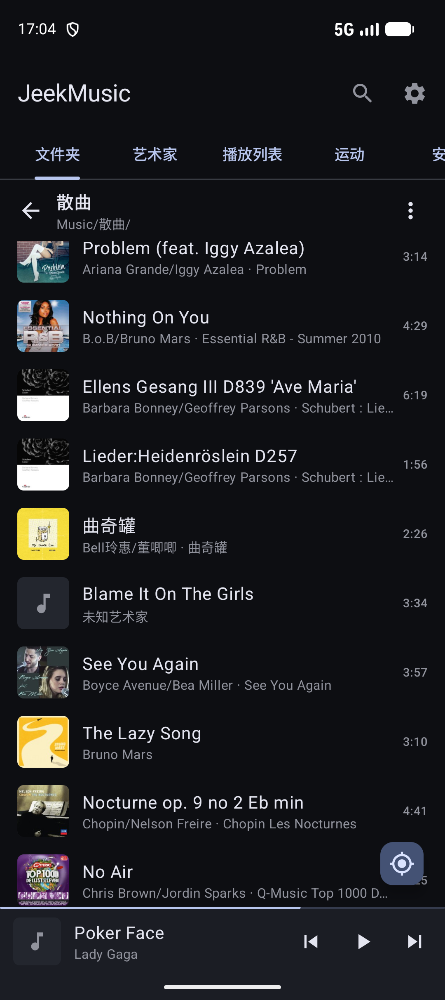
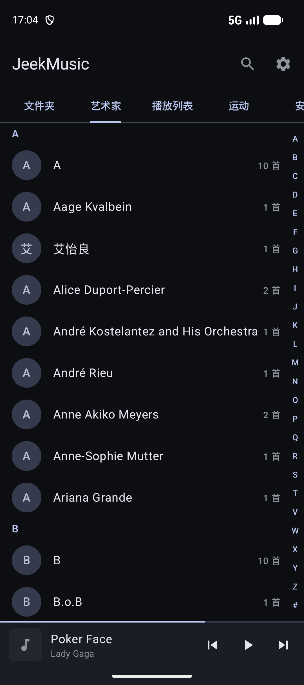
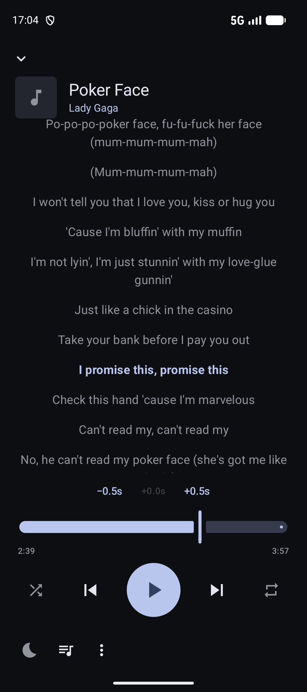
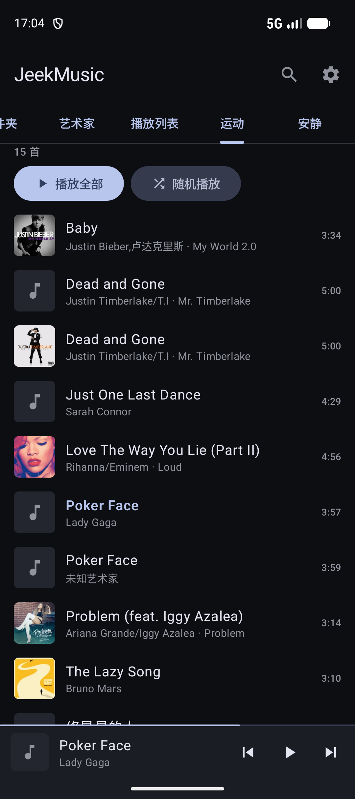

# Jeek Music

简洁的本地音乐播放器：围绕你选择的音乐文件夹组织曲库，不损音质，不做任何统计或追踪。

## 下载与更新

- **Windows x64**：打开 GitHub 桌面版发布列表，在最新版本的 Assets 中下载 `JeekMusic-desktop-*-win-x64.zip`。将整个文件夹解压到可写目录后运行 `JeekMusic.exe`，无需安装 .NET。客户端默认每天检查更新，也可以在“设置 → 关于”手动检查。[下载 Windows 桌面版](https://github.com/tifish/JeekMusic/releases?q=desktop-v1.0)
- **Android**：在 GitHub 最新发布的 Assets 中下载 APK，也可以在应用内检查更新。[下载 Android 版](https://github.com/tifish/JeekMusic/releases/latest)

## 目录结构

| 目录 | 内容 | 状态 |
|---|---|---|
| [`mobile/`](mobile/) | 移动端（Android，Kotlin + Jetpack Compose）：独立的 Gradle 工程，包含自己的文档（`mobile/docs/`）、开发脚本（`mobile/tools/`）和商店元数据（`mobile/fastlane/`） | 1.0 已发布，见 [Releases](https://github.com/tifish/JeekMusic/releases) |
| [`desktop/`](desktop/) | 桌面端（Windows，Avalonia + .NET） | 1.0 已发布 |

Windows 和 Android 各自通过 GitHub Actions 构建、测试和发布。

Windows 开发版本可双击根目录 `build-and-run.cmd` 编译并启动 `bin/JeekMusic.exe`。目录布局与数据迁移见[桌面端开发说明](desktop/README.md#开发与验证)。

## 许可证

[MIT](LICENSE)
