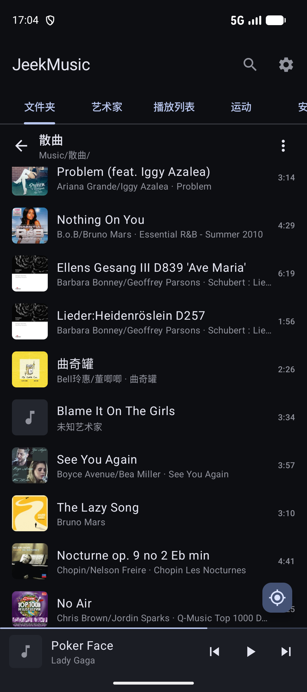
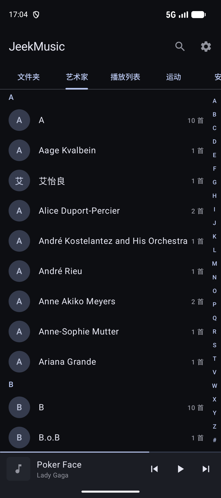
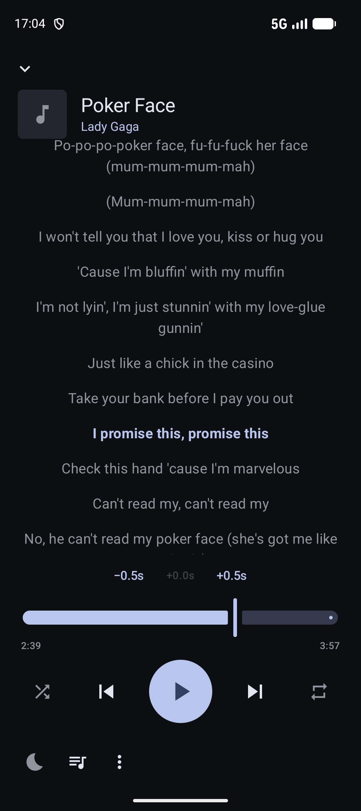
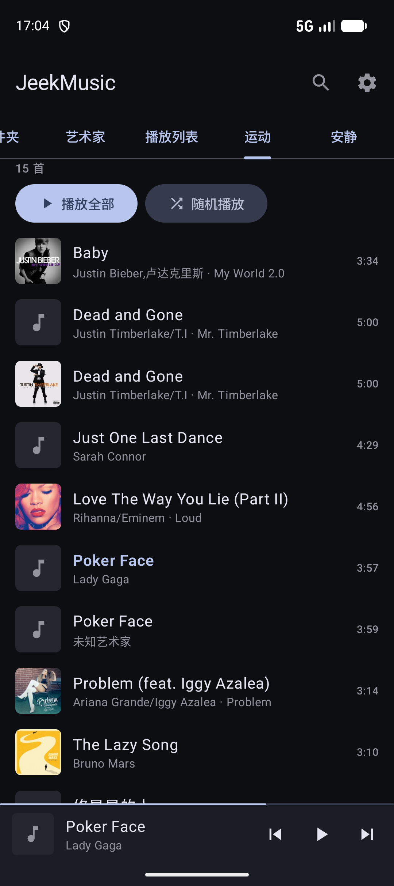

# JeekMusic 移动端（Android）

简洁的 Android 本地音乐播放器。围绕你选择的音乐文件夹组织曲库，不做任何统计或追踪；默认只有"检查更新"会联网（每天最多一次，可以关闭）。

<p>




</p>

## 功能

- **曲库**：多个音乐文件夹（含 SD 卡）在根一级并列浏览；艺术家按拼音 A–Z 排列，"A/B"、"A feat. B" 自动拆开；没有标签时从文件名推断艺术家；修复 GBK 乱码标签；CUE 整轨自动拆成单曲；常听的艺术家可以固定到标签栏
- **播放**：不损音质（不重采样、不加音效、24 位不截断）；熄屏低功耗播放（音频 offload）；断点续播；睡眠定时渐弱；播放列表与 m3u 导入导出
- **歌词**：同目录 .lrc 和内嵌歌词，同步滚动、双语、按首偏移；可选的在线歌词（LRCLIB，默认关闭），保存为 .lrc
- **智能标签**：在手机本地用 YAMNet 音频模型识别"运动 / 安静""人声 / 纯音乐""古典 / 流行"，默认只在充电时分析，可以手动修正；标题栏上组合筛选（比如"安静·纯音乐"），所有列表都只显示这类歌
- **备份与同步**：播放列表、固定标签、手动修正、歌词偏移和曲库规则保存到音乐文件夹的 `.jeekmusic/sync/`；每台设备只写自己的文件，与桌面端合并，冲突版本保留 30 天。旧 `backup.json` 可导入

需求与设计见 [docs/requirements.md](docs/requirements.md) 和 [docs/design.md](docs/design.md)。

## 构建

需要 JDK 17+ 和 Android SDK（compileSdk 37）。以下命令都在 `mobile/` 目录下执行，Android Studio 也打开 `mobile/` 目录。

```bash
./gradlew :app:assembleDebug          # 调试包
./gradlew :app:testDebugUnitTest      # 单元测试
./gradlew :app:assembleRelease        # 发布包（没有配置签名时使用 debug 签名）
```

正式签名：在 `mobile/` 目录创建 `keystore.properties`（已在 .gitignore 中）：

```properties
storeFile=release.jks
storePassword=...
keyAlias=...
keyPassword=...
```

版本号是 Git 提交数（`1.0.<提交数>`）。每次推送到 main 且改动了 `mobile/`，GitHub Actions（`.github/workflows/mobile.yml`）会跑测试、构建签名的 APK 并发布到 [Releases](https://github.com/tifish/JeekMusic/releases)，App 会自动检查并提示更新。签名文件放在仓库 Secrets 中：`KEYSTORE_BASE64`、`STORE_PASSWORD`、`KEY_ALIAS`、`KEY_PASSWORD`；本地构建必须使用同一个签名文件，否则装上去的包无法通过 App 内更新覆盖。

## 开发工具

| 脚本 | 用途 |
|---|---|
| `tools/push-testdata.sh` | 生成合成测试音频（中文标签、多艺术家、24 位 FLAC、CUE、歌词）并推送到模拟器 |
| `tools/pick_library_sample.py` | 从真实曲库中挑选边界情况的子集 |
| `tools/scan_id3.py` | 统计曲库的 ID3 标签情况 |
| `tools/ui.sh` | 模拟器 UI 自动化（按文字 / testTag 点击、截图、添加音乐文件夹） |
| `tools/measure-startup.sh` | 冷启动耗时测量（不依赖 Macrobenchmark，国产 ROM 也能用） |
| `tools/calibration-pcm.sh`、`tools/calibration/` | 智能标签校准：导出 16kHz PCM，在 PC 上跑 YAMNet，用人工标注（`labels.tsv`）评估准确度、调阈值 |
| `tools/store-screenshots.sh` | 截取应用商店截图 |

## 许可证

[MIT](../LICENSE)
