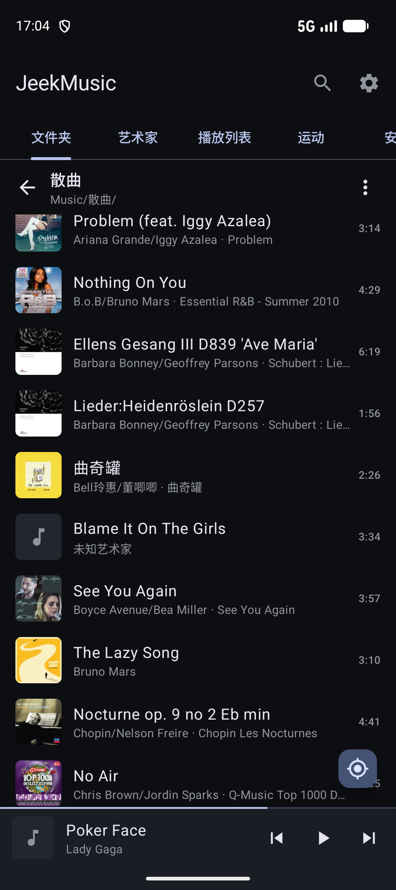
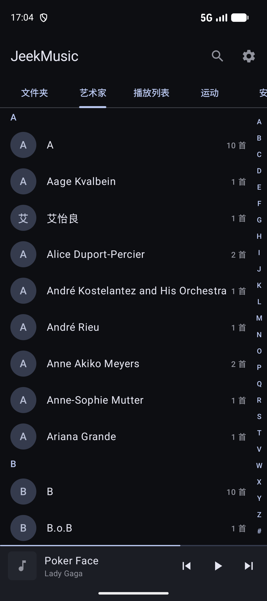
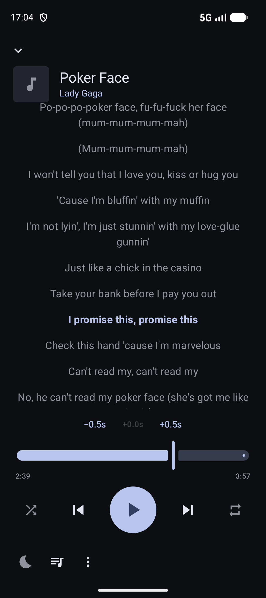
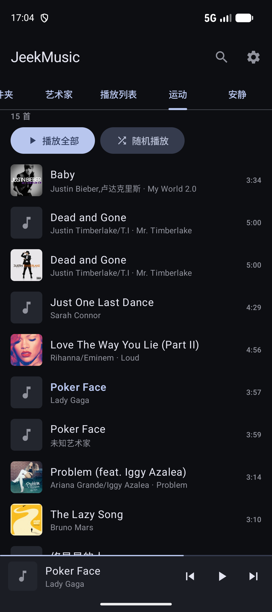

# Jeek Music 移动端（Android）

简洁的 Android 本地音乐播放器。围绕你选择的音乐文件夹组织曲库，不做任何统计或追踪；默认只有"检查更新"会联网（每天最多一次，可以关闭）。

<p>




</p>

## 功能

- **曲库**：多个音乐文件夹（含 SD 卡）在根一级并列浏览；艺术家按拼音 A–Z 排列，"A/B"、"A feat. B" 自动拆开；没有标签时从文件名推断艺术家；修复 GBK 乱码标签；CUE 整轨自动拆成单曲；常听的艺术家可以固定到标签栏
- **播放**：不损音质（不重采样、不加音效、24 位不截断）；熄屏低功耗播放（音频 offload）；断点续播；睡眠定时渐弱；播放列表与 m3u 导入导出
- **歌词**：同目录 .lrc 和内嵌歌词，同步滚动、双语、按首偏移；可选的在线歌词（LRCLIB，默认关闭），保存为 .lrc
- **智能标签**：在手机本地用 YAMNet 音频模型识别运动、人声、古典、安静四个独立维度及各自的否定类别，默认只在充电时分析，也可选择随时或仅手动分析；支持单首及批量手工修正，标题栏可组合筛选（比如“安静·纯音乐”），所有列表都按同一条件过滤
- **同步**：设置中统一管理电脑配对、同步目录、自动同步和任务状态。音乐文件双向同步，播放列表、固定标签、手动修正、歌词偏移和曲库规则与电脑合并。已有目录交换配置保留在“高级”中；手机不再提供独立备份、备份文件导入或恢复管理功能。内部事务恢复与冲突版本保护继续保留，不清除已有文件

“设置 → 同步 → 自动同步与状态”提供“仅在 Wi-Fi 下同步”，默认开启；关闭后允许移动网络。手动、前台自动、后台文件同步以及独立的用户数据、学习数据和冲突查询共用此策略。Wi-Fi 断开会关闭当前同步连接并显示等待提示，恢复后继续自动检查（后台执行时间仍由 Android 调度）。选项仅保存在本机，不随用户数据同步。实现与验收见 [Wi-Fi 同步策略](../docs/mobile-sync-wifi.md)。

支持汉字拼音首字母搜索（如 `zjl` 搜周杰伦）、七种歌曲排序及反向排序。多选歌曲可批量加入待播队列或播放列表、修正四维标签和恢复自动；设置可选择“仅手动分析”。

筛选面板的“演唱语言”提供中文／非中文、英文／非英文，按本手机的本地音频识别或明确手工纠正过滤。首次识别需确认下载约 78 MB 的 Whisper tiny 多语种模型；不上传音频，不修改音乐文件。未知、过期、未识别及纯音乐不匹配这四项，混合语种可以同时匹配中文和英文。已配对的新版本电脑与手机通过元数据同步交换语种结果和纠正；筛选偏好仍各端独立。规则、依赖版本和验收见[手机功能补齐](../docs/mobile-feature-parity.md)。

需求与设计见 [docs/requirements.md](docs/requirements.md) 和 [docs/design.md](docs/design.md)。

局域网文件同步：在 PC 明确启用曲库根，在手机通过一次性邀请配对，选择子目录和 SAF 目标后下载。详见 [首版契约与限制](../docs/lan-sync.md)。

## 构建

需要 JDK 17+ 和 Android SDK（compileSdk 37）。以下命令都在 `mobile/` 目录下执行，Android Studio 也打开 `mobile/` 目录。

```bash
./gradlew :app:assembleDebug          # 调试包
./gradlew :app:testDebugUnitTest      # 单元测试
./gradlew :app:assembleRelease        # 发布包（没有配置签名时使用 debug 签名）
```

正式签名：在 `mobile/` 目录创建 `keystore.properties`（已在 .gitignore 中）：

```properties
storeFile=release.jks
storePassword=...
keyAlias=...
keyPassword=...
```

版本号是 Git 提交数（`1.0.<提交数>`）。每次推送到 main 且改动了 `mobile/`，GitHub Actions（`.github/workflows/mobile.yml`）会跑测试、构建签名的 APK 并发布到 [Releases](https://github.com/tifish/JeekMusic/releases)，App 会自动检查并提示更新。签名文件放在仓库 Secrets 中：`KEYSTORE_BASE64`、`STORE_PASSWORD`、`KEY_ALIAS`、`KEY_PASSWORD`；本地构建必须使用同一个签名文件，否则装上去的包无法通过 App 内更新覆盖。

## 开发工具

| 脚本 | 用途 |
|---|---|
| `tools/push-testdata.sh` | 生成合成测试音频（中文标签、多艺术家、24 位 FLAC、CUE、歌词）并推送到模拟器 |
| `tools/pick_library_sample.py` | 从真实曲库中挑选边界情况的子集 |
| `tools/scan_id3.py` | 统计曲库的 ID3 标签情况 |
| `tools/ui.sh` | 模拟器 UI 自动化（按文字 / testTag 点击、截图、添加音乐文件夹） |
| `tools/measure-startup.sh` | 冷启动耗时测量（不依赖 Macrobenchmark，国产 ROM 也能用） |
| `tools/calibration-pcm.sh`、`tools/calibration/` | 智能标签校准：导出 16kHz PCM，在 PC 上跑 YAMNet，用人工标注（`labels.tsv`）评估准确度、调阈值 |
| `tools/store-screenshots.sh` | 截取应用商店截图 |

## 许可证

[MIT](../LICENSE)

运动分析采用 Analyzer 6 / Rules 8，保留原运动阈值并增加有条件的持续节奏证据；旧缓存渐进升级。实际修复范围、许可和验证见 [运动 v8](../docs/workout-music-v8.md)。
